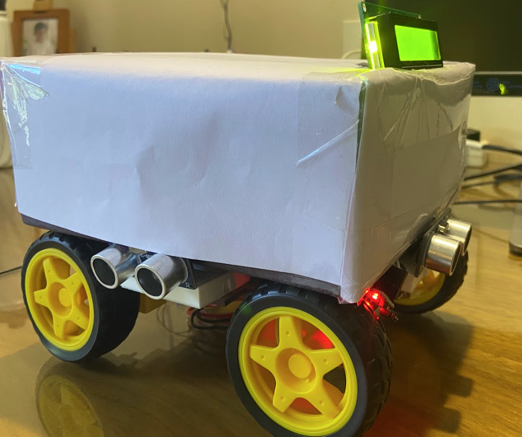
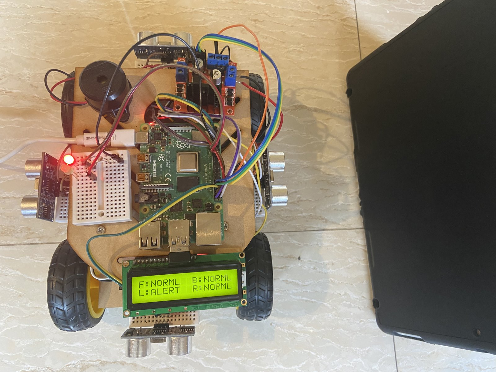
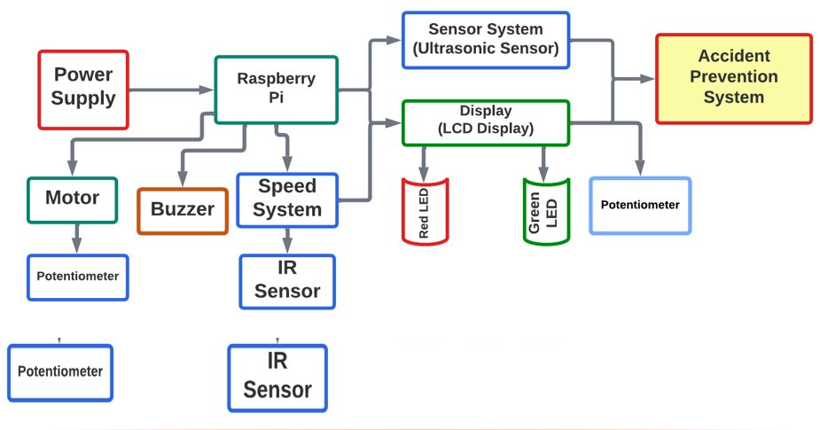
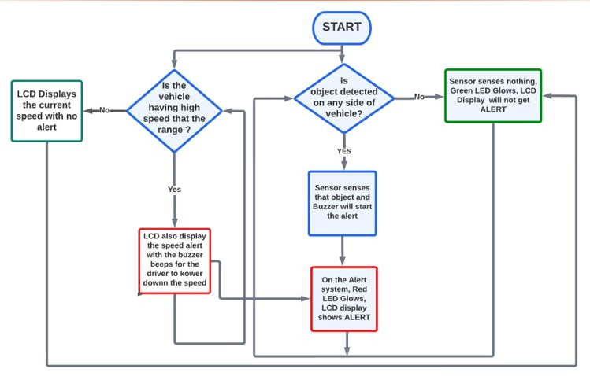

# Accident-Prevention-System

A small robot car that warns the driver when something gets too close to any side of the vehicle. It uses 4 HC-SR04 ultrasonic sensors (front, back, left and right) with a Raspberry Pi. When an object is within 20 cm of any sensor the red LED turns on, the buzzer sounds and the 16x2 LCD shows which side has the alert. If all sides are clear the green LED stays on.

[Working of Project](https://youtu.be/zP1oyWgRw0Y)



## How it works

`final_code.py` reads the four sensors one after another in a loop. Each reading sends a 10 us pulse on the trig pin, times the echo pulse and converts it to cm (time x 17150). Reading them one at a time stops a sensor from picking up the echo of another one. If a sensor gives no echo within 0.1 s it is skipped for that round so the loop does not get stuck.

The LCD shows the state of each side:

```
F:NORML B:NORML
L:ALERT R:NORML
```



The block diagram and flow chart also show a speed alert using an IR sensor. That part is not in this code, only the ultrasonic part is.





## Hardware

- Raspberry Pi 4
- 4 x HC-SR04 ultrasonic sensors
- 16x2 LCD with PCF8574 I2C backpack (address 0x27)
- Red LED, green LED and a buzzer
- Car chassis with motors

## Pins (BCM numbering)

| Part | Pin |
|------|-----|
| Front sensor trig / echo | 19 / 16 |
| Back sensor trig / echo | 26 / 20 |
| Left sensor trig / echo | 4 / 14 |
| Right sensor trig / echo | 17 / 18 |
| Red LED | 13 |
| Green LED | 21 |
| Buzzer | 27 |
| LCD | SDA / SCL (I2C bus 1) |

The HC-SR04 echo pin gives 5V, so use a voltage divider before connecting it to the Pi.

## Files

- `final_code.py` - main program
- `testing_ultrasonic.py` - reads the front sensor once, used to check the wiring
- `i2c_lcd.py`, `lcd_api.py` - LCD driver from [python_lcd](https://github.com/dhylands/python_lcd)

## Running

Enable I2C from `sudo raspi-config` (Interface Options) and install the packages:

```
sudo apt install python3-rpi.gpio python3-smbus i2c-tools
```

`i2cdetect -y 1` should show the LCD at 27. Then run:

```
python3 final_code.py
```

Press Ctrl+C to stop. It clears the LCD and resets the GPIO pins on exit.
